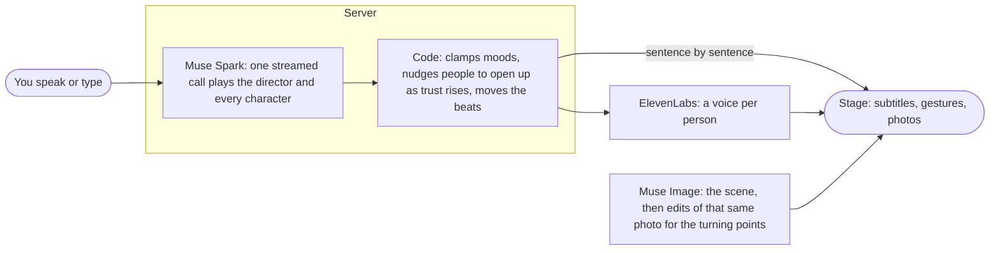

# Stand-In

Rehearse the conversation before it happens. Stand-In puts AI stand-ins in the room: each one has a private goal, a secret, and a mood that moves with every word you say. When the scene ends you see what they were hiding, and if it went wrong you can go back to the moment it turned and say it differently.

**Try it:** [stand-in.fly.dev](https://stand-in.fly.dev) (open in Chrome to answer by voice)

Built for the Meta Global AI Developer Hackathon with Muse Spark and Muse Image through the Meta Model API.

## Why

Some conversations you only get one shot at: telling your parents you quit your job, resigning, pitching investors, saying no to a landlord. You can't practise on the real people. A friend playing along goes easy on you, and a chatbot just agrees with you. Stand-In gives the other side its own reasons to push back, and things it will only tell you if you earn them.

## What you can do

- **Set yourself up on your first visit.** Language, your name, how you usually talk and a few personality questions are remembered in this browser, and suggested replies and auto mode then sound like you. *Hear their voices*, *Answer by voice* and the camera go back to their defaults each visit (Settings).
- **Pick a story or make your own.** 40 ready-made stories in English and 41 in Korean (family, love, mystery, history and legend, simulations), or describe a situation in one sentence, optionally with a photo and a genre; the story and its first photo are ready in about a minute. Once a story is open, you can talk it over with a director before you begin. A ready-made story stays as written unless you change the place; a one-sentence story is rewritten around your changes.
- **Talk to them.** Speak (Chrome) or type. Lines appear as subtitles over the scene photo, which moves to whoever is speaking, sometimes with a gesture. Turn on *Hear their voices* and each person speaks in their own voice. People walk in at turning points, time jumps ahead, and someone who runs out of patience walks out. Saying nothing for long enough is an answer too.
- **Earn the secrets.** Nobody hands over what they are hiding easily: ask the right thing, push twice, or show evidence, and the more they trust you the more they open up. In the ready-made stories, a secret someone gives up lands in your hands as a picture, and after the second turning point you may come across evidence against someone still hiding something, which you can lay on the table to press them.
- **Get help when the words won't come.** Three replies written the way you talk, and auto mode that plays your side until you click into the message box.
- **See how it ended.** An ending you earned (won, halfway, lost), judged against your goals, with what you never found out. If you fell short, "Go back to that moment" takes you to the turn that mattered. Each story keeps the endings you have reached.
- **Optional camera.** Gaze and head direction are computed in the browser with MediaPipe; video never leaves it. People react only to what they could have noticed.
- **No account.** Worlds you build are saved on the server under a random id kept in this browser. The interface speaks English, Korean and Japanese.

## How it works



**Muse Spark** (`muse-spark-1.3`) does all the writing, in roles with their own temperature and reasoning effort:

| role | what it does |
|---|---|
| actor | one streamed call per turn decides who answers, what they say, their gesture and expression, mood changes and any secret given up; `reasoning_effort` minimal so the first sentence can be spoken while the rest is still being written (about 3 s to first words). The same client writes the three suggested replies and auto mode's lines |
| writer | turns one sentence into a scenario (cast, private goals, secrets, turning points, success criteria) and writes the ending |
| checker | GATE 1: flags a scenario that is a chat rather than practice (every character must push against your goal, every goal must be judgeable from the dialogue); problems go back to the writer as repair notes, and the last version is used |
| builder | talks with you while you shape a world before it begins, asking for what is still missing, one thing at a time |

**Muse Image** (`muse-image-1.0`) paints each scene with the people in it. In one-sentence stories it then edits that same photo at each turning point ("change the photograph without touching anyone already in it"), so faces stay the same across the story; the ready-made stories ship with photos made the same way.

**Code, not the model**, owns what must stay reliable: moods are proposed by the model and clamped by code; code nudges each person to open up as trust rises (a hint at 50, telling plainly at 70), lets the biggest hidden truth come out near the end if you came close, and records the secrets the model reports as given up; every reply is validated against a schema and cached on disk by request; spend is tracked against a budget; each visitor address gets an hourly cap on API requests.

Voices come from ElevenLabs through OpenRouter, since the Meta Model API has no text-to-speech. Each sentence is voiced as soon as it is written, so speech starts before the turn is finished. Without a voice key the browser's own voices are used.

## Run it

```bash
uv run server.py        # http://localhost:8010, open in Chrome (speech recognition needs Chrome)
```

`.env`:

| variable | |
|---|---|
| `MODEL_API_KEY` | Meta Model API key. When set, all text and image calls go to Meta |
| `CSR_VLM_API_KEY` | OpenRouter key: voices, and the models when `MODEL_API_KEY` is empty (then set the model names below to OpenRouter models) |
| `CSR_VLM_BASE_URL` | another OpenAI-compatible endpoint for the text and image models instead of OpenRouter (voices still use OpenRouter) |
| `STANDIN_WRITER_MODEL`, `STANDIN_ACTOR_MODEL`, `STANDIN_CHECK_MODEL`, `STANDIN_IMAGE_MODEL`, `STANDIN_TTS_MODEL` | override a model (`STANDIN_USER_MODEL`: the simulated player in `play.py`) |
| `STANDIN_SERVER_BUDGET` | dollars the server may spend before model calls stop (default 3; resets on restart) |
| `STANDIN_HOURLY_LIMIT` | POST requests to `/api/` per visitor address per hour, except `/api/template`, `/api/build/finish` and `/api/start` (default 150; voices have their own 300). One request can make several model calls |
| `HOST`, `PORT` | default `127.0.0.1:8010` |

Other entry points:

```bash
uv run play.py "situation in one sentence"            # a text-only scene in the terminal (same engine), with a debrief
uv run play.py "..." --auto "the kind of player"       # a simulated player takes your turns
uv run make_preset.py <id> "situation" --episode       # a ready-made story with photos for the turning points (clue pictures are made separately)
uv run evaluate.py                                     # stress test: a strong and a weak simulated player per scene
```

## Deploy

Fly.io, one machine that never sleeps (scenes live in memory), with a volume at `/app/runs` for worlds, images, voices and the reply cache. `fly.toml` and `Dockerfile` are in the repo.

```bash
bash scripts/deploy.sh             # creates the app and volume if missing, sends the keys from .env as secrets, deploys
bash scripts/deploy.sh --secrets   # only the keys
```

## Layout

| file | role |
|---|---|
| `server.py` | FastAPI app: sessions, streaming turns, images, voices, limits and spend |
| `standin/spec.py` | the scenario: what the stage, the cast and the director need; goals and secrets are never shown during the scene |
| `standin/compiler.py` | one sentence (+ optional material) → scenario, with GATE 1 review and repairs |
| `standin/builder.py` | build a world by talking; keeps people and places exactly as you describe them |
| `standin/engine.py` | the scene loop: one streamed call per turn, code-owned moods, trust-based nudges to open up, arrivals and walk-outs |
| `standin/coach.py` | a live coach behind `/api/coach` that sees only what the player sees (the interface keeps it off for now) |
| `standin/ending.py` | the ending page: how it ended, judged against the goals |
| `standin/debrief.py` | the full debrief behind `/api/end` and in `play.py`: scoring and turning points, with every cited turn checked against the transcript |
| `standin/signals.py` | camera and voice numbers → what people in the room would notice (thresholds in code) |
| `standin/art.py` | scene photos and turning-point edits |
| `standin/voice.py` | a voice per person, cached by text |
| `standin/llm.py` | Meta Model API or any OpenAI-compatible endpoint: caching, schema validation, spend, latency |
| `standin/intake.py` | questions with recommended answers, used by `evaluate.py` |
| `static/index.html` | the whole front end: onboarding, stories, world building, stage, ending |
| `presets/` | ready-made stories; images in `presets/img/` |
| `demo/` | how the demo video was made: recorder, cards, narration and the edit |
